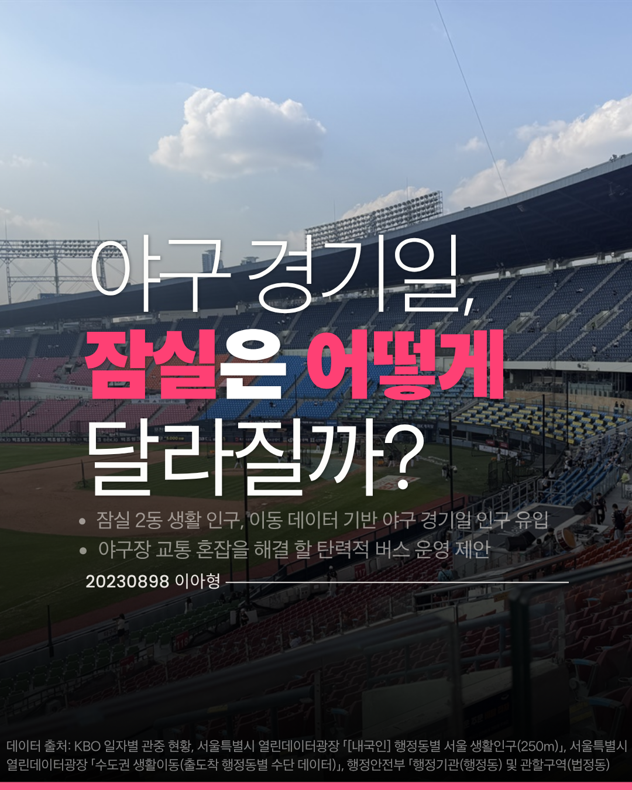
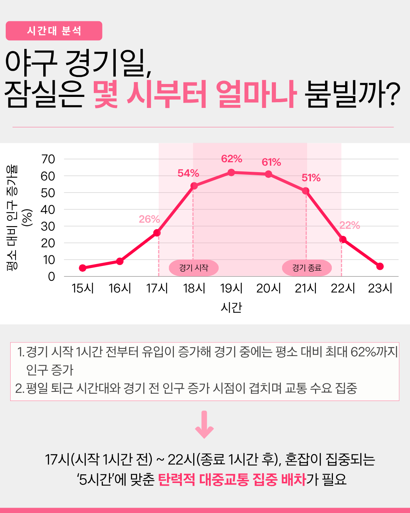
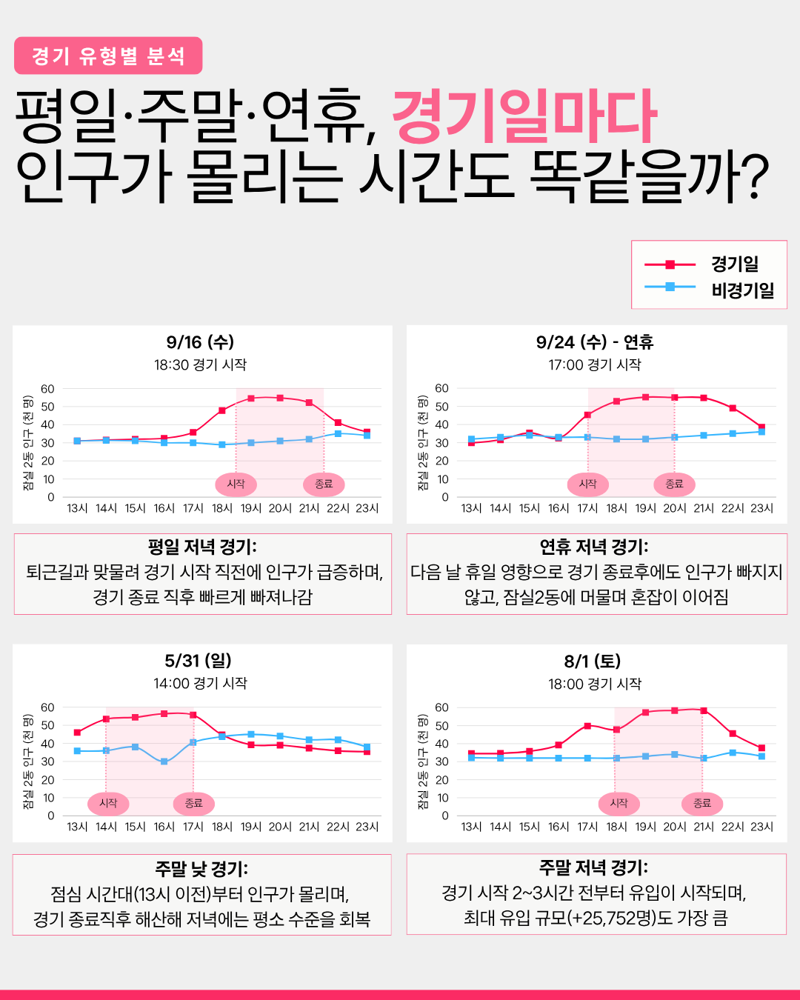
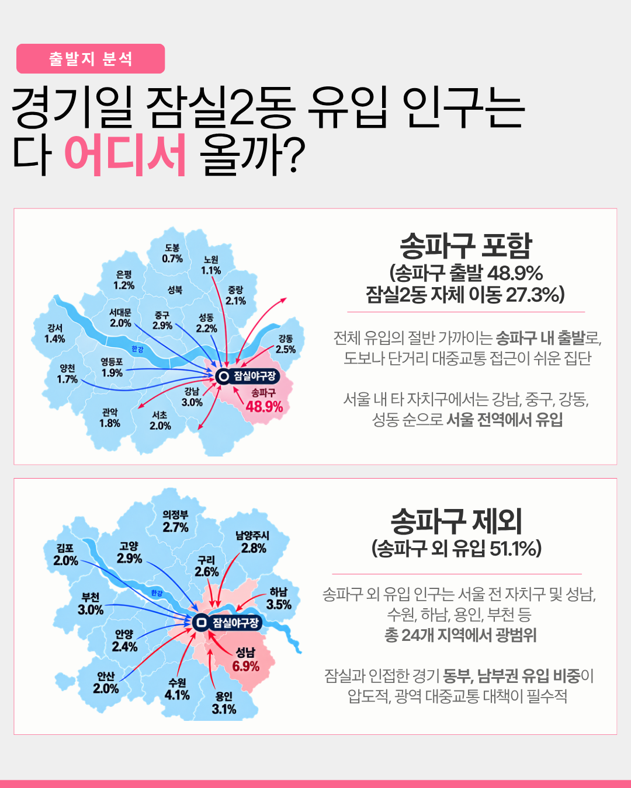
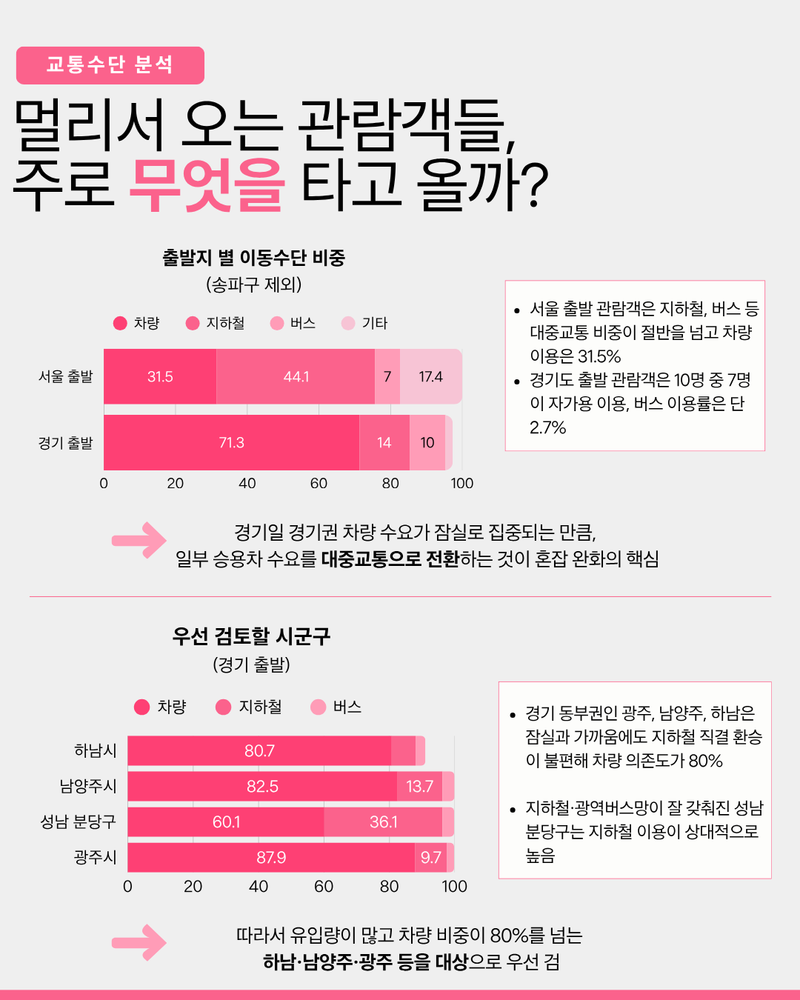
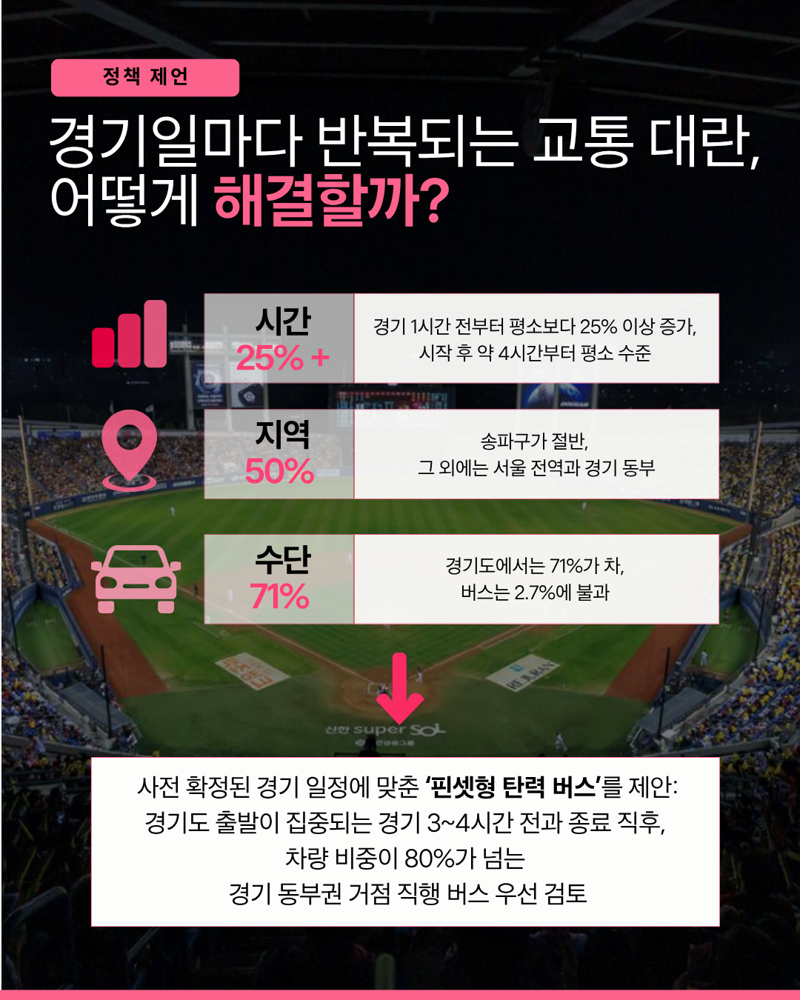

# 야구 경기일, 잠실은 어떻게 달라질까?

> 잠실 2동 생활인구·이동 데이터 기반 야구 경기일 인구 유입 분석, 그리고 야구장 교통 혼잡을 해결할 탄력적 버스 운영 제안

## 목차

1. [프로젝트 개요](#1-프로젝트-개요)
2. [시간대 분석 - 몇 시부터 얼마나 붐빌까?](#2-시간대-분석---몇-시부터-얼마나-붐빌까)
3. [경기 유형별 분석 - 경기일마다 인구가 몰리는 시간도 똑같을까?](#3-경기-유형별-분석---경기일마다-인구가-몰리는-시간도-똑같을까)
4. [출발지 분석 - 유입 인구는 다 어디서 올까?](#4-출발지-분석---유입-인구는-다-어디서-올까)
5. [교통수단 분석 - 멀리서 오는 관람객들은 주로 무엇을 타고 올까?](#5-교통수단-분석---멀리서-오는-관람객들은-주로-무엇을-타고-올까)
6. [정책 제안 - 경기일마다 반복되는 교통 대란, 어떻게 해결할까?](#6-정책-제안---경기일마다-반복되는-교통-대란-어떻게-해결할까)

---

## 1. 프로젝트 개요

야구 경기일에는 잠실 일대가 평소와 어떻게 달라지는지를 **생활인구**와 **이동 데이터**로 확인하고, 그 결과를 바탕으로 교통 혼잡을 줄일 대중교통 운영 방안을 제안합니다.

- 잠실 2동 생활인구와 이동 데이터를 바탕으로 야구 경기일 인구 유입 패턴 분석
- 야구장 교통 혼잡을 해결할 **탄력적 버스 운영** 제안

**분석 질문**

| # | 분석 | 질문 |
|---|---|---|
| 2 | 시간대 | 몇 시부터, 얼마나 붐비는가? |
| 3 | 경기 유형 | 평일·주말·연휴 경기마다 인구가 몰리는 시간도 같은가? |
| 4 | 출발지 | 유입 인구는 어디서 오는가? |
| 5 | 교통수단 | 먼 곳에서 오는 관람객은 무엇을 타고 오는가? |

**데이터 출처**

- KBO 일자별 관중 현황
- 서울특별시 열린데이터광장 「[내국인] 행정동별 서울 생활인구(250m)」
- 서울특별시 열린데이터광장 「수도권 생활이동(출도착 행정동별 수단 데이터)」
- 행정안전부 「행정기관(행정동) 및 관할구역(법정동)」

---

## 2. 시간대 분석 - 몇 시부터 얼마나 붐빌까?

경기일 잠실 2동 생활인구의 평소 대비 증가율을 시간대별로 본 결과입니다.

| 시간 | 17시 | 18시 | 19시 | 20시 | 21시 | 22시 |
|---|---|---|---|---|---|---|
| 평소 대비 증가율 | 26% | 54% | **62%** | 61% | 51% | 22% |

- 경기 시작 1시간 전부터 유입이 증가해, 경기 중에는 평소 대비 **최대 62%까지** 인구가 증가합니다.
- 평일 퇴근 시간대와 경기 전 인구 증가 시점이 겹치며 교통 수요가 집중됩니다.

➡️ **17시(시작 1시간 전) ~ 22시(종료 1시간 후), 혼잡이 집중되는 '5시간'에 맞춘 탄력적 대중교통 집중 배차가 필요합니다.**

---

## 3. 경기 유형별 분석 - 경기일마다 인구가 몰리는 시간도 똑같을까?

경기일과 비경기일의 잠실 2동 시간대별 인구(13~23시)를 경기 유형별로 비교했습니다.

| 경기 | 시작 | 유형 | 특징 |
|---|---|---|---|
| 9/16 (수) | 18:30 | 평일 저녁 | 퇴근길과 맞물려 경기 시작 직전에 인구가 급증하며, 경기 종료 직후 빠르게 빠져나감 |
| 9/24 (수) | 17:00 | 연휴 저녁 | 다음 날 휴일 영향으로 경기 종료 후에도 인구가 빠지지 않고 잠실 2동에 머물며 혼잡이 이어짐 |
| 5/31 (일) | 14:00 | 주말 낮 | 점심 시간대(13시 이전)부터 인구가 몰리며, 경기 종료 직후 해산해 저녁에는 평소 수준을 회복 |
| 8/1 (토) | 18:00 | 주말 저녁 | 경기 시작 2~3시간 전부터 유입이 시작되며, 최대 유입 규모(+25,752명)도 가장 큼 |

---

## 4. 출발지 분석 - 유입 인구는 다 어디서 올까?

### 송파구 포함

- 송파구 출발 **48.9%**, 잠실 2동 자체 이동 27.3%
- 전체 유입의 절반 가까이는 송파구 내 출발로, 도보나 단거리 대중교통 접근이 쉬운 집단입니다.
- 서울 내 타 자치구에서는 강남(3.0%), 중구(2.9%), 강동(2.5%), 성동(2.2%) 순으로 서울 전역에서 유입됩니다.

### 송파구 제외 (송파구 외 유입 51.1%)

- 서울 전 자치구 및 성남, 수원, 하남, 용인, 부천 등 **총 24개 지역**에서 광범위하게 유입됩니다.
- 잠실과 인접한 경기 **동부, 남부권** 유입 비중이 압도적이며(성남 6.9%, 수원 4.1%, 하남 3.5%, 용인 3.1% 등), 광역 대중교통 대책이 필수적입니다.

---

## 5. 교통수단 분석 - 멀리서 오는 관람객들은 주로 무엇을 타고 올까?

### 출발지별 이동수단 비중 (송파구 제외, %)

| 출발지 | 차량 | 지하철 | 버스 | 기타 |
|---|---|---|---|---|
| 서울 출발 | 31.5 | 44.1 | 7 | 17.4 |
| 경기 출발 | **71.3** | 14 | 2.7 | 10 |

- 서울 출발 관람객은 지하철, 버스 등 대중교통 비중이 절반을 넘고 차량 이용은 31.5%입니다.
- 경기도 출발 관람객은 10명 중 7명이 자가용을 이용하며, 버스 이용률은 단 2.7%입니다.
- 경기일 경기권 차량 수요가 잠실로 집중되는 만큼, **일부 승용차 수요를 대중교통으로 전환**하는 것이 혼잡 완화의 핵심입니다.

### 우선 검토할 시군구 (경기 출발, 차량 비중 %)

| 시군구 | 차량 |
|---|---|
| 광주시 | 87.9 |
| 남양주시 | 82.5 |
| 하남시 | 80.7 |
| 성남 분당구 | 60.1 (지하철 36.1) |

- 경기 동부권인 광주, 남양주, 하남은 잠실과 가까움에도 지하철 직결 환승이 불편해 차량 의존도가 80%입니다.
- 지하철·광역버스망이 잘 갖춰진 성남 분당구는 지하철 이용이 상대적으로 높습니다.
- 따라서 유입량이 많고 차량 비중이 80%를 넘는 **하남·남양주·광주 등을 대상**으로 우선 검토합니다.

---

## 6. 정책 제안 - 경기일마다 반복되는 교통 대란, 어떻게 해결할까?

| 구분 | 핵심 수치 | 내용 |
|---|---|---|
| 시간 | **25%+** | 경기 1시간 전부터 평소보다 25% 이상 증가, 시작 후 약 4시간부터 평소 수준 |
| 지역 | **50%** | 송파구가 절반, 그 외에는 서울 전역과 경기 동부 |
| 수단 | **71%** | 경기도에서는 71%가 차, 버스는 2.7%에 불과 |

### 제안: 핀셋형 탄력 버스

사전 확정된 경기 일정에 맞춘 **'핀셋형 탄력 버스'** 를 제안합니다.

- **언제**: 경기도 출발이 집중되는 경기 3~4시간 전과 종료 직후
- **어디서**: 차량 비중이 80%가 넘는 경기 동부권 거점
- **어떻게**: 잠실로 가는 직행 버스를 우선 검토
